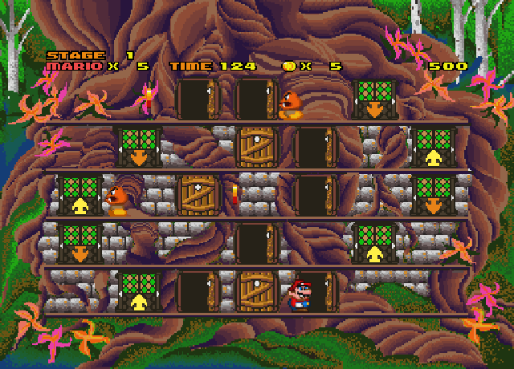
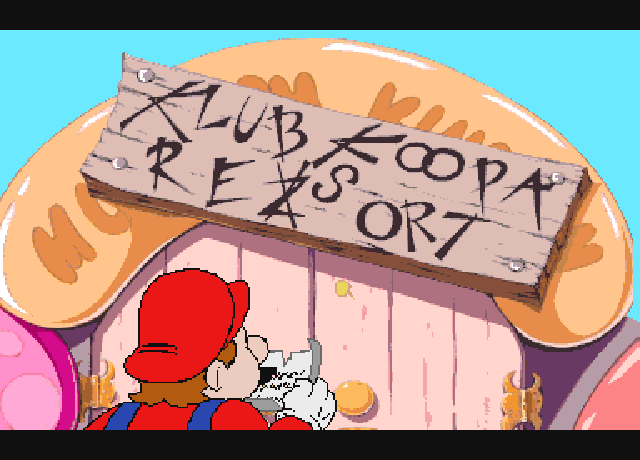
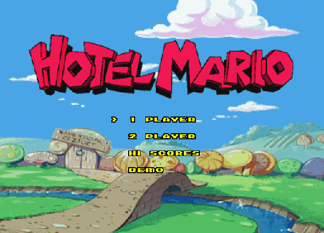

# Hotel Mario for Sega Dreamcast

A native Sega Dreamcast port of the 1994 Philips CD-i game **Hotel Mario**, built on a
decompilation of the CD-i game which was part of this project.

**No game data is included.** You need your own legally owned copy of the Hotel Mario
CD-i disc. The build reads the game's graphics, stages, sound, music and cutscenes from
an image of your disc and puts them on the disc image that it makes. Please don't share
any disc images that you might build.





## AI Disclosure

This port was written with the assistance of AI. Many hours of human testing were spent on real Dreamcast hardware, and then refining the game. If this use of AI is in conflict with your personal beliefs or values, please leave this page now. Thanks.

## Features

The CD-i game's own code, decompiled and translated to C, running natively on the Dreamcast,
with the original stages, enemies, bosses, menus, music, sound effects and cutscenes.

Build 36 includes:

- The hotel campaign, including upper rooms, and boss stages.
- One-player and two-player modes, a demo and a high-score table.
- Full Dreamcast controller mapping.
- VMU saving for game progress and high scores.
- Two optional cheats activated with the Dreamcast controller.

## Requirements

- [KallistiOS](https://github.com/KallistiOS/KallistiOS) with its SH-4 toolchain
  (`kos-cc`), set up and working, and [SH4ZAM](https://github.com/gyrovorbis/sh4zam)
  and zlib installed from kos-ports.
- [mkdcdisc](https://gitlab.com/simulant/mkdcdisc), to make the `.cdi` disc image.
- A C compiler (`cc`) and Python 3 with Pillow and NumPy.
- A local [Musashi](https://github.com/kstenerud/Musashi) source tree with generated `m68kops.c`.
- Your own Hotel Mario CD-i disc, as a raw BIN image with 2352 bytes per sector.

## Building

1. You must own Hotel Mario for the CD-i. Make a raw BIN image of your own disc.
2. Load the KallistiOS environment:

   ```sh
   source /opt/toolchains/dc/kos/environ.sh
   ```

3. Build from the top folder of this project, replacing the example Musashi and BIN paths:

   ```sh
   MUSASHI=/path/to/Musashi
   cc -O2 -I"$MUSASHI" -o tools/sprite_runner tools/sprite_runner.c \
     "$MUSASHI/m68kcpu.c" "$MUSASHI/m68kops.c" "$MUSASHI/m68kdasm.c" \
     "$MUSASHI/softfloat/softfloat.c" -lm
   python3 tools/extract_disc.py /path/to/hotel-mario.bin extracted
   python3 tools/build_image.py extracted work
   python3 tools/make_dc_assets.py extracted dc/data
   python3 tools/make_movie_assets.py extracted dc/data work/movie-preview
   bash dc/build_dc.sh
   ```

The build reads the game's files from your disc image (into `extracted/`), prepares
the game image (in `work/`), converts its data and movies for the Dreamcast (into
`dc/data/`), compiles the game and makes **`dc/hotel-mario-dreamcast.cdi`**. Run
`bash tools/check_pc.sh` after asset conversion to exercise the host tests.

## Running

- **Real Dreamcast:** copy `dc/hotel-mario-dreamcast.cdi` to your GDEMU (or burn it to a CD-R).
- **Emulator:** open `dc/hotel-mario-dreamcast.cdi` in [Flycast](https://github.com/flyinghead/flycast).

## Controls

| Button | Gameplay |
|---|---|
| D-Pad Left / Right | Move |
| D-Pad Up / Down | Use Lifts |
| A | Jump |
| B | Open or Close Doors |
| X | Run |
| Y | Use the Fire Flower |
| Start | Pause (Resume / Hotel Map / Return to Title) |

Hold **A + B + X + Y + Start** together to go back to the title screen.

## Saving

Plug in a VMU. Game progress is saved to one of five slots (file `HOTELMARIO`).
Choose **Restore** from the player menu to load a saved game. High scores are saved
separately (file `HMARIO.SYS`).

## Cheats

Hold a trigger when selecting **1 Player** on the main menu. Then choose **New** or
**Restore** as usual. Hold both triggers when selecting **1 Player** to enable both cheats.

| Button | Cheat |
|---|---|
| Left Trigger | Mario is invincible and can still pick up items, stomp enemies and fire fireballs. |
| Right Trigger | The stage timer starts at 500 (instead of 200). |

## Layout

| Folder | Contents |
|---|---|
| `src/` | Shared types and structures from the CD-i game. |
| `dc/` | The game and the Dreamcast side, including graphics, sound, controllers, VMU and the build script. |
| `tools/` | What the build uses to read your disc image and convert the game's data and movies. |
| `dc/assets/` | The port's own art (the VMU save icon). |
| `images/` | The screenshots on this page. |

## Credits

- [KallistiOS](https://github.com/KallistiOS/KallistiOS) and the Dreamcast homebrew
  community, [SH4ZAM](https://github.com/gyrovorbis/sh4zam),
  [mkdcdisc](https://gitlab.com/simulant/mkdcdisc), [Flycast](https://github.com/flyinghead/flycast).
- [Musashi](https://github.com/kstenerud/Musashi) is used by the sprite conversion tools.
- Hotel Mario was released by Philips Interactive Media for the CD-i. Mario and related
  characters belong to Nintendo.
- This is a non-commercial preservation project independent of Philips, Nintendo and Sega.
